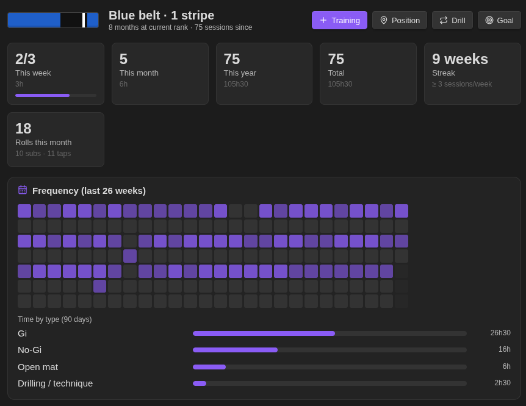
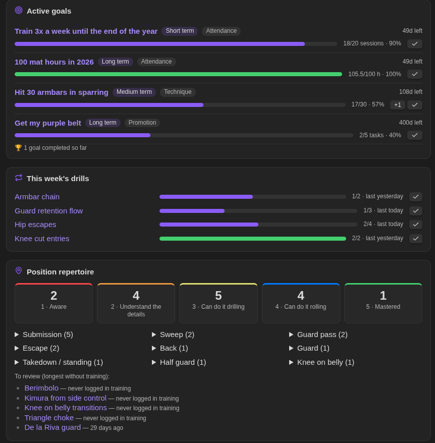
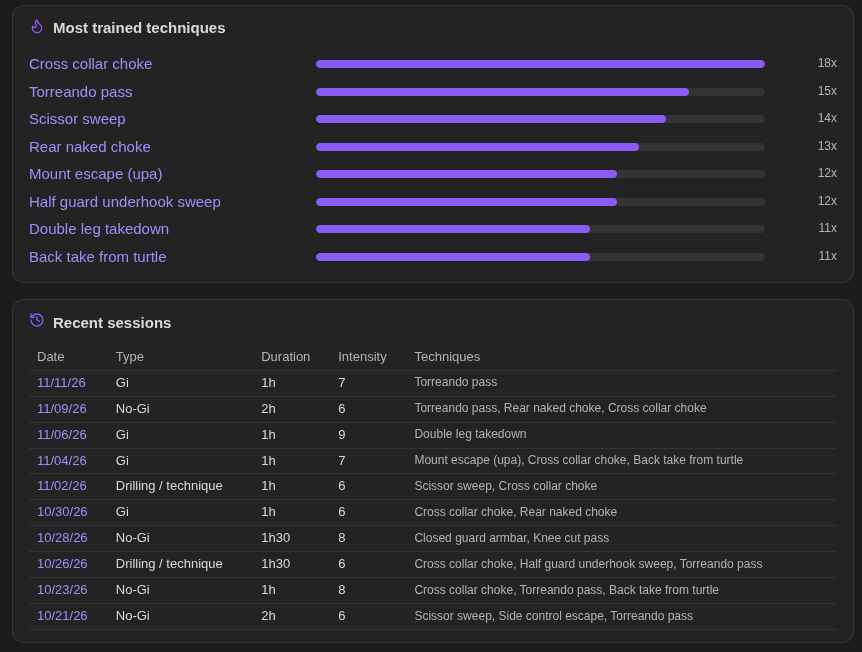
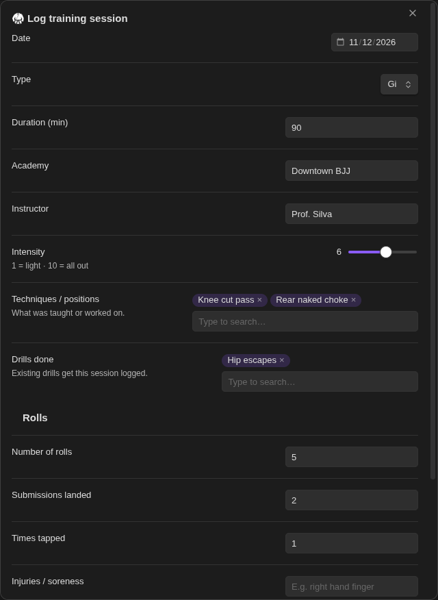
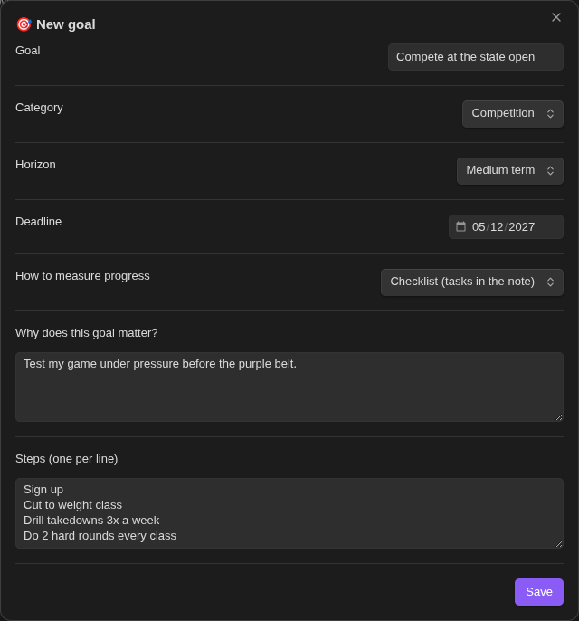
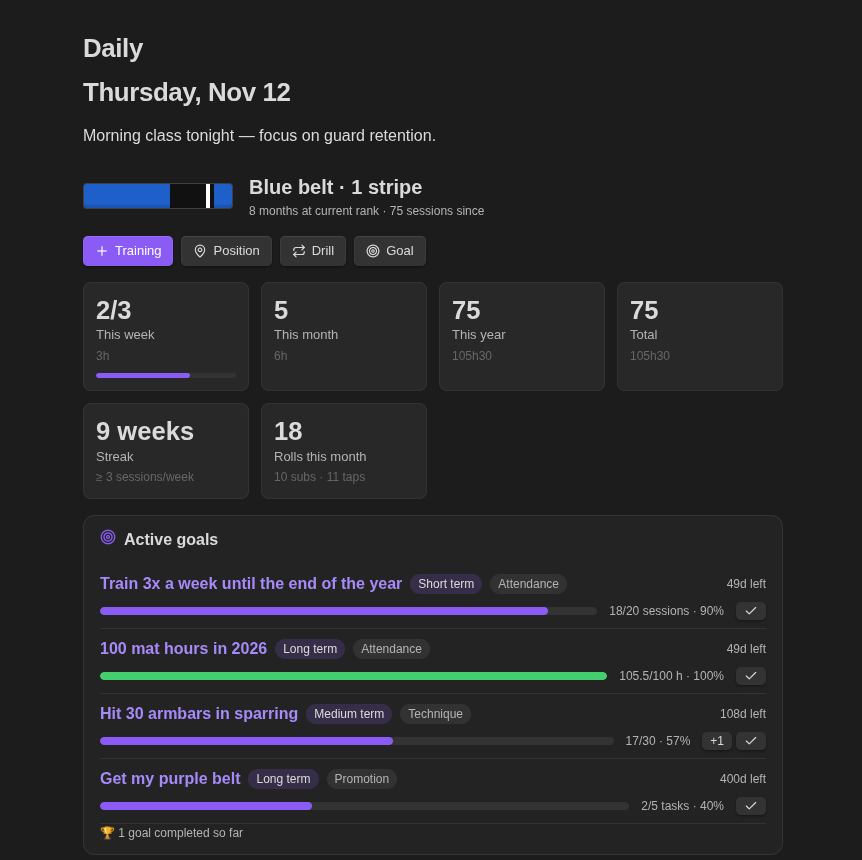

# BJJ Tracker

An [Obsidian](https://obsidian.md) plugin to log your Brazilian Jiu-Jitsu **training sessions**, **positions & techniques**,
**drills** and **goals** as regular notes, and follow your progress on a stats dashboard.

Everything is plain Markdown with properties (frontmatter): edit notes by hand, move them anywhere in your vault,
or query them with Bases / Dataview. The interface is available in **English** and **Portuguese (Brazil)**,
picked automatically from Obsidian's language setting.



## Features

### Dashboard

- **Rank**: current belt and stripes, time at the current rank and sessions since your last promotion.
- **Stats**: sessions and mat time this week (against your weekly goal), this month, this year and in total.
  Also your weekly streak, and rolls, submissions and taps this month.
- **Frequency heatmap** of the last 26 weeks, plus mat time per training type over the last 90 days.
- **Active goals** with progress bars, days left (or overdue), a **+1** button for manual goals and a
  ✓ button to complete them.
- **This week's drills** against each drill's weekly target, with a ✓ button to log a session today.
- **Position repertoire** by proficiency level and category, and the positions you haven't trained the longest.
- **Most trained techniques** and a table of **recent sessions**.
- Quick buttons to log a training session or create a position, drill or goal.





### Training log

Date, type (Gi, No-Gi, open mat, private lesson, competition…), duration, academy, instructor and intensity (1–10).
Also the techniques and drills you worked on, rolls, submissions landed, times tapped, injuries and notes.

Techniques and drills are entered as chips that suggest your existing notes as you type. A name that doesn't exist yet
becomes a link you can fill in later. Logging a session with drills also records that session in each drill note.

<p align="center"></p>

### Positions & techniques

A library of positions with category (guard, passing, sweeps, submissions, escapes, takedowns…), perspective
(top / bottom / neutral) and a proficiency level:

| Level | Meaning |
|---|---|
| 1 | Aware |
| 2 | Understand the details |
| 3 | Can do it drilling |
| 4 | Can do it rolling |
| 5 | Mastered |

Each position note comes with sections for key details, step by step, common mistakes, follow-ups, counters,
related positions and references (e.g. a video link).

### Drills

Sets × reps, time, positions trained and a weekly target. Every session is stored as a date in the note, so the
dashboard can show how many times you drilled each one this week.

### Goals

Short, medium or long term goals with category, deadline and status (`active`, `paused`, `done`, `abandoned`).
Progress is tracked automatically:

| Metric | How progress is measured |
|---|---|
| Checklist | Ticked `- [x]` tasks in the goal note |
| Number of sessions | Training notes between `start` and `deadline` |
| Mat hours | Sum of training `duration` between `start` and `deadline` |
| Manual | The `progress` counter, incremented with the dashboard's **+1** button |

<p align="center"></p>

### Dashboard in any note

Drop any part of the dashboard into a note, such as your daily note, with a `bjj` code block. An empty block
renders the whole dashboard; otherwise list the sections you want:

````markdown
```bjj
summary
goals
drills
```
````

Sections: `summary`, `heatmap`, `goals`, `drills`, `positions`, `techniques`, `recent`.
Blocks update when your BJJ notes or the plugin settings change.



## Commands

Open the dashboard from the ribbon (swords icon) or the command palette. The ribbon also has a button to log a training session.

| Command | What it does |
|---|---|
| Open dashboard | Opens the stats dashboard in a new tab |
| Log training session | Form to log a session |
| New position / technique | Form to add a position to your library |
| New drill | Form to create a drill |
| New goal | Form to create a goal |
| Log drill session (today) | Pick a drill and log a session for today |
| Change position proficiency level | Uses the active note if it is a position, otherwise asks which one |
| Complete goal | Uses the active note if it is a goal, otherwise asks which one |

## Settings

The settings are listed in Obsidian's settings search.

- **Rank**: belt, stripes and last promotion date.
- **Training**: default academy, instructor, training type and duration, and your weekly training goal (used for
  the weekly stat and the streak).
- **Folders**: root folder (default `BJJ`) and the subfolders for training, positions, drills and goals, and
  whether to open notes after creating them.

## Note format

The `bjj` property identifies the note type. Example training note:

```yaml
---
bjj: training
date: 2026-11-12
type: Gi
duration: 90
academy: My Academy
instructor: Professor X
intensity: 7
rolls: 5
submissions_given: 2
submissions_received: 1
techniques: ["[[Armbar from closed guard]]"]
drills: ["[[Hip escapes]]"]
injuries: ""
tags: [bjj/training]
---
```

| Type | Main properties |
|---|---|
| `training` | `date`, `type`, `duration`, `intensity`, `rolls`, `submissions_given`, `submissions_received`, `techniques`, `drills` |
| `position` | `category`, `perspective`, `level` (1–5), `video`, `related` |
| `drill` | `positions`, `sets`, `reps`, `time_min`, `weekly_target`, `sessions` (list of dates) |
| `goal` | `category`, `horizon`, `status` (`active` / `paused` / `done` / `abandoned`), `start`, `deadline`, `metric`, `target`, `progress` |

Notes you create by hand work too, as long as they have the `bjj` property.

## Installation

Requires Obsidian 1.13 or later.

**Community plugins**: Settings → Community plugins → Browse → search for "BJJ Tracker".

**Manual**: download `main.js`, `manifest.json` and `styles.css` from the
[latest release](https://github.com/diogoleal/obsidian-bjj-tracker/releases/latest) into
`<vault>/.obsidian/plugins/bjj-tracker/`, then enable the plugin.

**BRAT**: add `diogoleal/obsidian-bjj-tracker` as a beta plugin.

## Development

```bash
npm install
npm run dev                                   # rebuild on change
npm run lint                                  # Obsidian's official ESLint rules
npm run build                                 # type-check + lint + production build
VAULT=/path/to/vault npm run install-vault    # copy the build into a vault
```

### Releasing

Add a `## <version>` section to [CHANGELOG.md](CHANGELOG.md) (it becomes the release notes), then:

```bash
npm version patch        # bumps package.json, manifest.json and versions.json
git push --follow-tags   # the Release workflow builds, attests and attaches main.js, manifest.json, styles.css
```

## License

[MIT](LICENSE)
